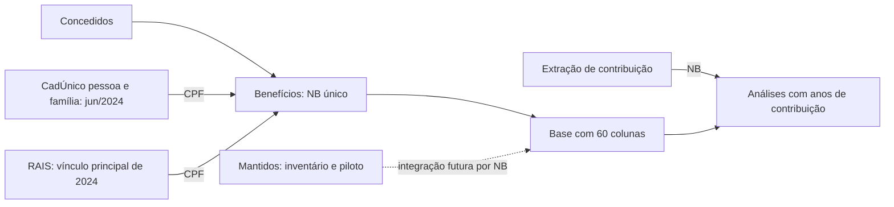

# BPI

Projeto para estudar a base identificada de benefícios integrada ao CadÚnico e à
RAIS e preparar uma base inteiramente sintética com o mesmo formato e relações.
Esta etapa organiza e documenta os anexos. **A base teste ainda não foi gerada.**

## O que está sendo feito nos arquivos

O núcleo é `tb_beneficio`: **uma linha por número de benefício (NB)**, com
Concedidos das espécies **21 (pensão por morte), 41 (aposentadoria por idade) e
88 (BPC ao idoso)**. A ligação ao CadÚnico de junho/2024 e à RAIS 2024 é por CPF.
Um CPF pode ter vários benefícios: contagens de NBs não são contagens de pessoas.

O esquema observado no HTML de dicionário tem **60 colunas**: 26 do INSS, 17 do
CadÚnico, 14 da RAIS e três de renda familiar. O complemento de contribuição
acrescenta `qt_anos_contribuicao` por NB quando incorporado à análise, formando
uma visão de 61 colunas. A integração de **Mantidos** é um ramo ainda em estudo
para identificar situação e duração, sem comprovar automaticamente posição em
julho de 2026.

## Conteúdo do projeto

| Caminho | Conteúdo |
|---|---|
| [BPI.Rproj](BPI.Rproj) | Projeto RStudio; sem restauração automática da sessão |
| [docs/entendimento.md](docs/entendimento.md) | Fluxo, regras, leitura dos HTMLs e pontos a corrigir antes de executar |
| [docs/plano_base_sintetica.md](docs/plano_base_sintetica.md) | Especificação da próxima etapa |
| [esquemas/banco_beneficio_cad_rais.csv](esquemas/banco_beneficio_cad_rais.csv) | As 60 colunas e tipos observados no HTML de dicionário |
| [esquemas/contribuicao_nb.csv](esquemas/contribuicao_nb.csv) | Layout da tabela final de contribuição, com três colunas |
| [esquemas/contribuicao_staging.csv](esquemas/contribuicao_staging.csv) | Cinco colunas antes da deduplicação |
| [esquemas/mantidos_piloto.csv](esquemas/mantidos_piloto.csv) | Mapeamento das 12 posições usadas no piloto, dentro do CSV de 51 posições |
| [referencia/codigos/](referencia/codigos/) | 13 códigos recebidos, preservados sem modificações |
| [docs/arquivos_recebidos.csv](docs/arquivos_recebidos.csv) | Inventário e hashes SHA-256 dos 19 anexos |
| [docs/relatorios_html.csv](docs/relatorios_html.csv) | Registro de leitura dos seis HTMLs |
| [dados/](dados/) e [saidas/](saidas/) | Pastas locais reservadas para a próxima etapa |

Os HTMLs foram lidos, mas não copiados para o Git: alguns contêm prévias de
registros individuais, inclusive identificador de benefício anterior. O projeto
versiona somente os códigos e os metadados necessários para preparar a simulação.

## Abrir no RStudio

Abra `BPI.Rproj`. A leitura e a organização atuais não exigem instalar pacotes
ou acessar bancos. Os scripts recebidos usam `DBI`, `duckdb`, `data.table`,
`dplyr` e `knitr`; os relatórios também exigem `rmarkdown` e Pandoc.

Os códigos em `referencia/codigos` são **referência de análise**, ainda não um
pipeline executável do BPI. Possuem caminhos locais fixos, operações que recriam
arquivos e trechos de diagnóstico adicionados ao final. Não foram executados;
serão adaptados para as pastas e os dados sintéticos do projeto na próxima etapa.

## Próxima etapa

Gerar dados aleatórios reprodutíveis, mantendo o esquema de 60 colunas, chaves
NB/CPF coerentes, combinações de localização CadÚnico/RAIS, renda familiar,
datas e uma tabela auxiliar de contribuição. Os parâmetros de tamanho, semente,
frequências e ausências serão explícitos; o resultado será uma base de teste
funcional, sem pretensão de representar a distribuição real da população.
