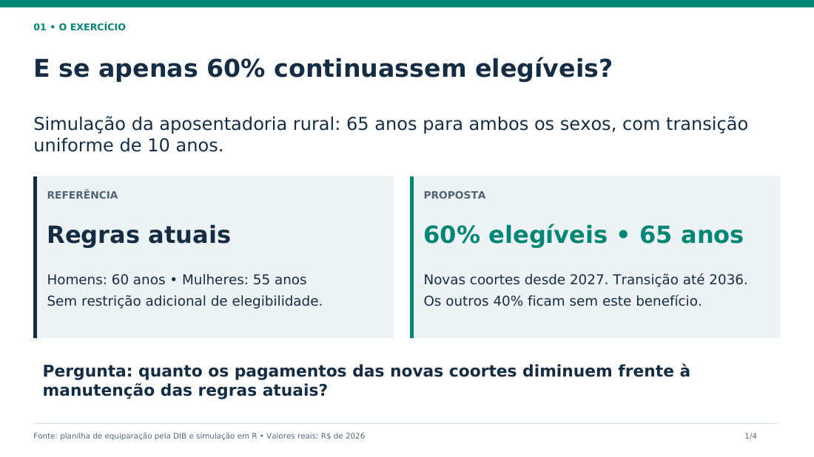
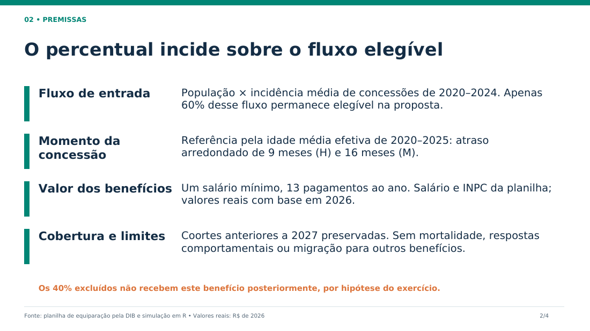
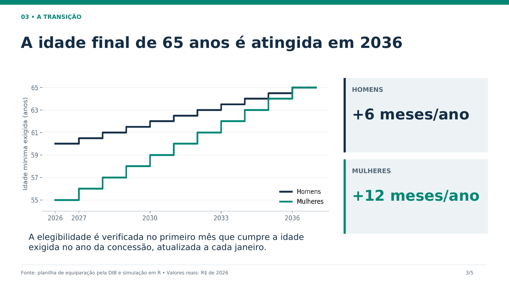
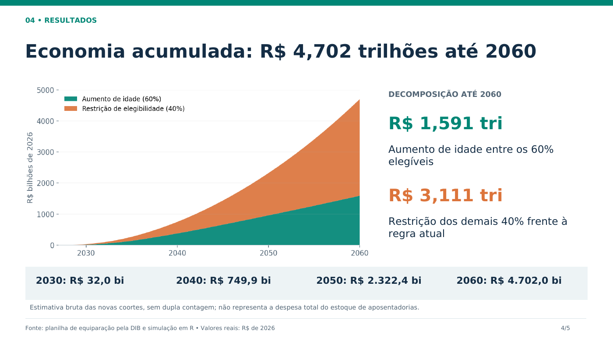
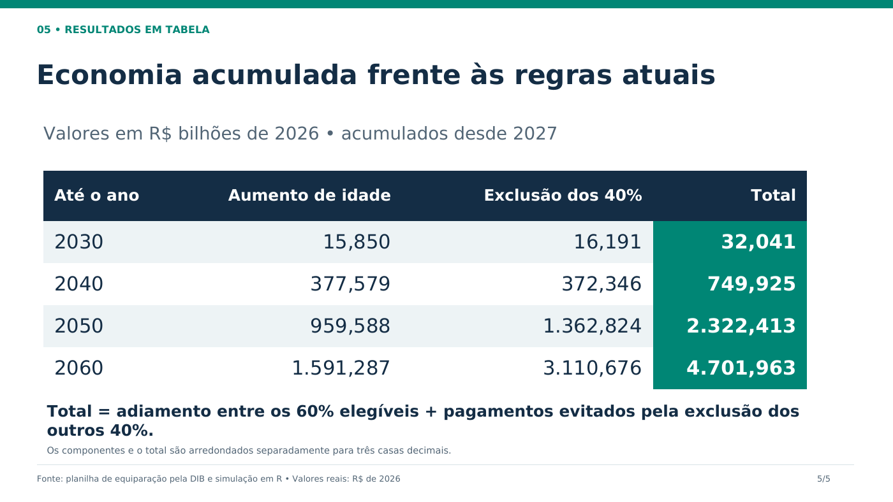

# Aposentadoria rural: cenário de 60% elegíveis

[Ver a nova apresentação com as três tabelas comparativas](tres-cenarios/README.md)

Apresentação com cinco slides. A referência mantém as regras atuais, sem redução
adicional de elegibilidade; a proposta considera 60% do fluxo elegível, ambos os
sexos aos 65 anos e transição de 2027 a 2036. Valores reais de 2026.

[Baixar PowerPoint editável](Cenario_60_porcento.pptx?raw=true) ·
[Abrir PDF](Cenario_60_porcento.pdf)

## 1. O exercício

## 2. Premissas

## 3. Transição

## 4. Resultados

## 5. Tabela de resultados acumulados

Fonte: [projeção anual em R](../resultados/cenario_60_porcento.csv).
A estimativa até 2060 é de R$ 4,702 trilhões: R$ 1,591 trilhão pela idade entre
os elegíveis e R$ 3,111 trilhões pela exclusão dos demais 40%, sem dupla contagem.
