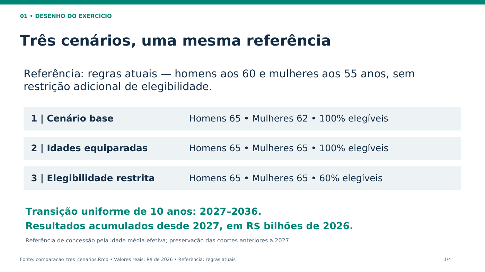
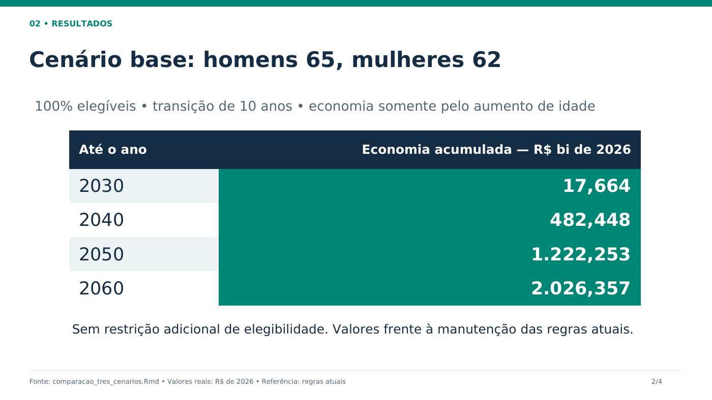
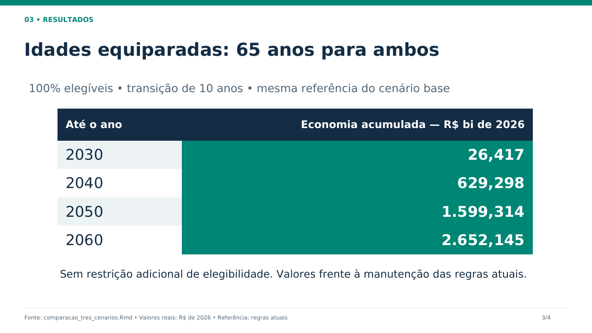
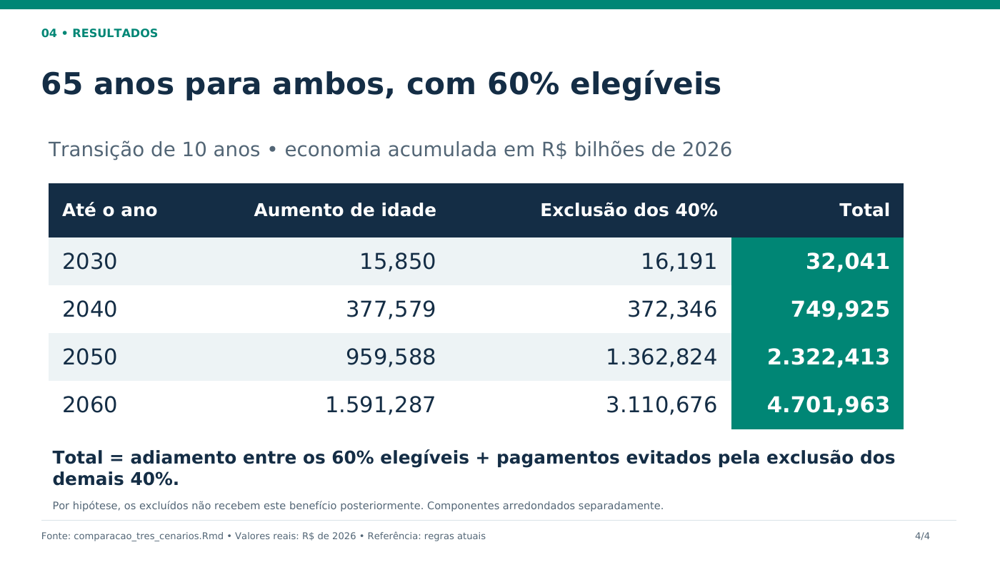

# Três cenários de aposentadoria rural

Apresentação com quatro slides: uma introdução e uma tabela para cada cenário.
Todos usam transição uniforme de 2027 a 2036 e referência nas regras atuais
(H60/M55), sem restrição adicional de elegibilidade. Os valores são economia
acumulada desde 2027, em **R$ bilhões de 2026**.

- [Baixar PowerPoint editável](Comparacao_tres_cenarios.pptx?raw=true)
- [Abrir PDF](Comparacao_tres_cenarios.pdf)

## 1. Referência e cenários

## 2. Homens aos 65 e mulheres aos 62 — 100% elegíveis

## 3. Homens e mulheres aos 65 — 100% elegíveis

## 4. Homens e mulheres aos 65 — 60% elegíveis

O percentual de 60% incide sobre o fluxo que seria elegível na regra atual,
igualmente por sexo e coorte. Os outros 40% permanecem sem este benefício,
por hipótese. A referência continua sem essa restrição. A decomposição do
terceiro cenário soma os dois efeitos sem dupla contagem.

Fonte: [R Markdown consolidado](../../comparacao_tres_cenarios.Rmd) e
[resumo das projeções](../../resultados/tres_cenarios_resumo_bilhoes.csv).

Para gerar novamente o PowerPoint e PDF, instale `python-pptx` e `reportlab`,
com a fonte DejaVu Sans disponível, e execute `python gerar_apresentacao.py`.
